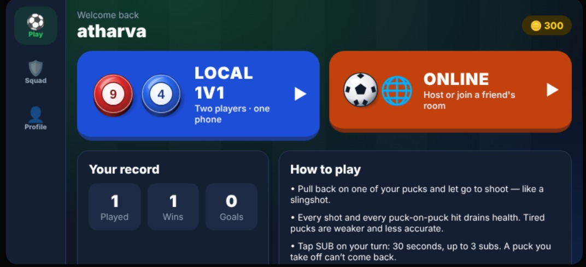

# ⚽ Soccer Pucks

A turn-based **soccer flick game** for Android and iOS, built with **React Native + Expo**.
Pull back a puck, let it fly, bank the ball off the walls and score — against a friend on the same phone or **online**.


---

## 📸 Screenshots

<!--
  HOW TO ADD YOUR PHOTOS:
  1. Create a folder called  docs/screenshots  in the project root.
  2. Put your images in it with the file names used below (or change the names here).
  3. Commit and push — GitHub shows them automatically.
-->

| Login | Home |
|:---:|:---:|
|  |  |

| Match | Aiming a shot |
|:---:|:---:|
|  |  |

| Substitutions | Trick-shot shootout |
|:---:|:---:|
|  |  |

| Squad & formations | Puck upgrades |
|:---:|:---:|
|  |  |

| Online lobby | Profile & stats |
|:---:|:---:|
|  |  |

<!-- Optional: a short gameplay GIF -->
<!-- <p align="center"></p> -->

---

## ✨ Features

### 🎮 Gameplay
- **Flick-to-shoot** — pull back on a puck and release like a slingshot; live aim guide with power ring, direction arrow and power %
- **Custom 2D physics engine** — impulse-based circle collisions with mass, friction, wall & goal-post bounces, sub-stepping so fast pucks never pass through each other
- **Goal rules** — a goal counts when the whole ball crosses the line; pucks may slide into the net and are moved back out once everything stops
- **Turn timer** (15 s) — run out of time and the turn passes
- **Match modes** chosen by the host: **2 / 5 / 7 / 10 minutes** or **first to 2 / 5 goals**
- **Trick-shot shootout** on a draw — defender places the keeper, shooter beats fixed obstacle blocks (bank shots!), 5 kicks each then sudden death
- **Pause menu** in local matches

### 🛡️ Pucks & squad
- **8 pucks per player** — 5 starters + 3 on the bench
- **4 stats per puck:** 💥 Power · 🎯 Accuracy · 📏 Aim (guide length) · 🔋 Stamina
- **Health system** — shots and puck-on-puck hits drain health; tired pucks shoot weaker and less accurately; health resets every match
- **Substitutions** — 30-second window, max 3 per match, a puck taken off can't return
- **Upgrades** — level each stat of each puck individually (1–10) with coins
- **Rename pucks** and track per-puck career stats (goals, shots, appearances)
- **5 formations** (2-2, 1-2-1, 2-1-1, 3-1, 1-3) with live preview and a tap-to-swap lineup editor
- **9 puck colors**

### 🌐 Multiplayer
- **Local 1v1** — two players, one phone
- **Online 1v1** — create a room, share the 4-letter code, play
- **Server-authoritative** — the server runs every online match with the same rules code as the app, so both players always see the same game and nobody can cheat
- ~30 state updates per second, smoothly interpolated on the device
- Leaving mid-match counts as a forfeit

### 👤 Accounts & progression
- Register / login (scrypt-hashed passwords, session tokens, auto-login)
- Career stats: played, wins, losses, win %, goals, conceded, trick-shot wins
- Coins: **+100** win · **+40** loss · **+15** per goal

### 🎨 UI & performance
- Full **landscape** app with a side tab rail and two-column screens
- **3D-style SVG pucks** (side wall, glossy top, emblem, health ring) and a detailed pitch (mowing stripes, markings, nets, posts, boards)
- **Smooth 60 fps** — positions are animated on the UI thread with Reanimated shared values instead of re-rendering React every frame
- Animated GOAL!, win screen and menus

---

## 🛠️ Tech stack

| Area | Technology |
|---|---|
| App | React Native, Expo SDK 58, TypeScript |
| Navigation | Expo Router (file-based routing, stack + tabs) |
| Animation | React Native Reanimated 4 |
| Graphics | react-native-svg |
| State | React Context (auth), custom hooks, refs for the game loop |
| Storage | AsyncStorage (login token) |
| Server | Node.js, Socket.IO, JSON-file database, scrypt hashing |
| Architecture | One shared TypeScript rules engine used by both the app and the server |

---

## 🧠 How it works

```
            ┌──────────────────────────── src/game/ ────────────────────────────┐
            │  physics.ts   match.ts   pucks.ts   formations.ts   colors.ts     │
            │        (pure TypeScript — no React Native imports)                │
            └───────────────┬───────────────────────────────┬───────────────────┘
                            │                               │
                 Local match: runs on the phone   Online match: runs on the server
                            │                               │
                  useLocalMatch() game loop          server/index.ts (60 Hz)
                            │                               │  Socket.IO (~30 Hz)
                            ▼                               ▼
                 Reanimated shared values  ◄──────  useOnlineMatch() + interpolation
                            │
                            ▼
                 UI thread moves the pucks (no React re-render per frame)
```

- **Rules engine (`src/game/`)** — turns, clock, goals, health, substitutions and the shootout. Because it has no React Native code, the Node server imports the exact same files.
- **Smooth rendering** — the game loop writes positions into a Reanimated shared value; each puck's animated style reads it on the UI thread. React only re-renders when something visible changes (score, turn, timer second, health).
- **Online** — clients only send inputs (`shoot`, `sub`, `keeper`…). The server validates them, simulates the match and streams snapshots back.

---

## 📁 Project structure

```
HelloWorld/
├── app.json
├── server/                     # Game server (Node + Socket.IO)
│   ├── index.ts                # accounts, profiles, rooms, online matches
│   ├── db.ts                   # JSON-file database (server/data/db.json)
│   └── package.json
└── src/
    ├── app/                    # Screens (Expo Router)
    │   ├── _layout.tsx         # root stack, landscape lock, auth provider
    │   ├── login.tsx
    │   ├── (tabs)/             # Play · Squad · Profile
    │   ├── puck/[id].tsx       # rename + upgrade a puck
    │   ├── match-setup.tsx     # local match settings
    │   ├── online.tsx          # host / join room, lobby
    │   └── game.tsx            # the match
    ├── components/
    │   ├── game/               # field, 3D puck art, match view, formation preview
    │   └── ui/                 # buttons, cards, layouts, color & settings pickers
    ├── game/                   # Shared rules engine (app + server)
    │   ├── physics.ts
    │   ├── match.ts
    │   ├── pucks.ts
    │   ├── formations.ts
    │   ├── colors.ts
    │   └── types.ts
    └── lib/
        ├── auth.tsx            # login state (React Context)
        ├── socket.ts           # Socket.IO connection
        └── use-match.ts        # local + online match hooks
```

---

## 🚀 Getting started

### Prerequisites
- [Node.js](https://nodejs.org/) 18+
- The **Expo Go** app on your phone
- Phone and computer on the **same Wi-Fi**

### 1. Install the app
```bash
git clone <your-repo-url>
cd HelloWorld
npm install
npx expo install expo-screen-orientation react-native-svg socket.io-client @react-native-async-storage/async-storage
```

### 2. Start the game server
```bash
cd server
npm install
npm start
```
The terminal prints the address to use in the app, e.g. `http://192.168.1.10:3001`.
> On Windows, click **Allow** if the firewall asks about Node.js.

### 3. Start the app
```bash
# in the project root
npx expo start -c
```
Scan the QR code with Expo Go, **Register**, and enter the server address from step 2.

### 4. Play online
Both players register (different usernames) → one taps **Online → Create room** → the other joins with the 4-letter code → host taps **Start match**.

---

## 🎯 How to play

1. **Touch one of your pucks, pull back, release** — the shot goes the opposite way.
2. Pucks glow when it's your turn; you have **15 seconds** per turn.
3. Watch the **health ring** — tired pucks are weaker. Tap **SUB** to swap them (3 per match).
4. Win coins and **upgrade** your pucks in the Squad tab.
5. Draw at full time? Win the **trick-shot shootout**.

---

## 🗺️ Roadmap
- [ ] Host the server online (Render / Railway) to play over mobile data
- [ ] Sound effects and haptics
- [ ] Single-player mode vs. AI
- [ ] Leaderboards and friends list
- [ ] Unlockable puck designs

---

## 👨‍💻 Author

**Atharva Narvekar**
<!-- Add your links -->
- GitHub: [@your-username](https://github.com/your-username)
- LinkedIn: [your-profile](https://linkedin.com/in/your-profile)

---

<p align="center">Made with ⚽ and React Native</p>
